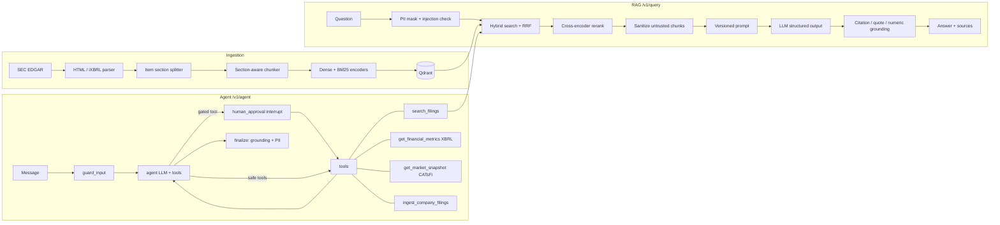

# CATsFi FinSight

**Grounded RAG + agentic research over SEC filings, built as a production-style LLM service.**

FinSight answers analyst questions about 10-K / 10-Q filings with verifiable citations. Its research agent combines
three sources: filing search, audited XBRL fundamentals from the SEC, and the technical-analysis engine of
**CATsFi**, my quantitative-finance platform (RSI, RSI divergences, SMA trend filter, density-based support/resistance).
Every answer is checked against its evidence before it is returned. Agent actions with side effects pause for human approval.

```
FastAPI · LangGraph · Qdrant (dense + BM25 hybrid, RRF) · fastembed (bge-small + MiniLM cross-encoder)
OpenAI · Azure OpenAI · Anthropic · OpenAI-compatible (Ollama / vLLM / Gemini) · offline mode
OpenTelemetry · Prometheus · Grafana · Docker · Kubernetes · GitHub Actions
```

---

## Highlights

| Area | What is implemented |
|---|---|
| **Document ingestion** | SEC EDGAR client (fair-access throttling, retries, disk cache) → inline-XBRL HTML parser (hidden facts removed, financial tables kept as rows) → **Item-aware section splitter** (handles the table of contents, running page headers, and 10-Q Part I/II) → token-budgeted, **section-aware chunking** with sentence-aligned overlap and contextual headers → idempotent upserts keyed by accession number |
| **Retrieval** | Qdrant named vectors: **dense** (bge-small ONNX) + **sparse BM25** (IDF applied server-side) fused with **Reciprocal Rank Fusion**, metadata filters (ticker / form / fiscal year / section), **cross-encoder reranking** |
| **Generation** | Provider-agnostic LLM layer with **tool/function calling** and **structured outputs** (JSON Schema + Pydantic validation + automatic repair loop) for OpenAI, Azure OpenAI, Anthropic and OpenAI-compatible endpoints |
| **Prompts** | **Versioned YAML templates** (`rag_answer@v1`, `@v2`, …) with content hashes attached to every trace, response and evaluation report; per-request A/B via `prompt_version` |
| **Agent** | **LangGraph** state machine: guard → plan / tool calls (parallel) → **human-in-the-loop interrupt** for gated tools → tools → verify. Checkpointed threads give multi-turn memory and pause/resume over the API |
| **Hallucination mitigation** | Citation validity, verbatim-quote fuzzy verification, **numeric fidelity** (every number in the answer must appear in the evidence), groundedness score, policy = pass / flag / abstain |
| **Security** | Direct **and indirect** prompt-injection defense (poisoned sentences are removed from retrieved chunks, the rest is kept), **PII masking** before any LLM call or log (email, phone, SSN, Luhn-checked cards, IBAN mod-97, Turkish ID checksum), API keys with roles, rate limiting, non-root container |
| **Evaluation** | Offline harness covering retrieval (hit@k, MRR), answers (keyword recall, groundedness, citation validity, abstention accuracy), guardrails (injection precision/recall/F1), latency p50/p95 and cost. It compares retrieval modes and prompt versions, runs as a **CI quality gate**, and can log to **MLflow** |
| **Observability** | OpenTelemetry spans for every stage (retrieval, rerank, LLM, tools, guardrails) exported via OTLP (Jaeger / Tempo / Langfuse / Azure Monitor), Prometheus metrics (latency, tokens, **USD cost**, groundedness, guardrail events, tool calls, pending approvals), a provisioned Grafana dashboard, and JSON logs with trace IDs |
| **Cost & latency** | Answer cache (TTL + LRU, cleared automatically on ingest), embedding batching, per-model price table, configurable candidate depth for the latency/quality trade-off |
| **Delivery** | Multi-stage Docker image (models baked in), docker-compose stack (API + Qdrant + Jaeger + Prometheus + Grafana), Kubernetes manifests (kustomize), Render blueprint, GitHub Actions (lint → tests + coverage → eval gate → image build → container smoke test → push to GHCR) |

---

## Architecture



### Request lifecycle (RAG)
1. **Input guardrails.** PII is masked, so it never reaches the provider or the logs. The injection detector scores the
   question. In `block` mode an attack never reaches the LLM: 0 tokens are spent.
2. **Cache.** The key covers (normalised question, filters, prompt version, top_k, retrieval mode, model).
3. **Hybrid retrieval.** Dense and BM25 prefetch (30 each), RRF fusion (20), cross-encoder rerank, top_k.
4. **Indirect injection defense.** Retrieved text is untrusted. Injected sentences are stripped, the rest is kept.
5. **Generation.** A versioned prompt with explicit data/instruction separation, and a `RAGAnswer` schema
   (answer, citations with verbatim quotes, confidence, insufficient_context).
6. **Verification.** Invalid citations, unverifiable quotes and numbers that are not in the evidence trigger
   *abstain* (`block` mode) or *flag* (`flag` mode).

---

## Results

Measured with `python -m finsight.eval.runner`. Full reports are in [`reports/`](reports).

**Real SEC filings.** AAPL 10-K FY2025, MSFT 10-K FY2026, NVDA 10-K FY2026; 521 chunks; 12 questions, 2 of them
unanswerable. Embeddings: `bge-small-en-v1.5`. CPU only.

| Retrieval | Reranker | hit@5 | MRR | p50 latency |
|---|---|---|---|---|
| dense only | none | 0.90 | 0.75 | 49 ms |
| BM25 only | none | 0.90 | 0.73 | 117 ms |
| **hybrid (RRF)** | none | **1.00** | **0.80** | 133 ms |
| hybrid (RRF) | MiniLM cross-encoder | 1.00 | 0.90 | 2.4 s |

* Hybrid fusion fixes the misses of each single retriever. The cross-encoder raises MRR further at a CPU latency cost.
  Lower `RERANK_CANDIDATES` or use a GPU to reduce that cost.
* Prompt-injection detector on the adversarial set (10 attacks, 10 hard benign look-alikes such as "ignore the noise in
  quarterly numbers…"): **precision 1.0 / recall 1.0**.
* A poisoned paragraph planted in a test filing is sanitized before it reaches the model, and the legitimate
  sentences around it are still answerable.
* These numbers come from the offline extractive answerer, a deterministic, key-less baseline. Answer-quality metrics
  with a hosted LLM come from the same command once `LLM_PROVIDER` is set.

> The eval set is small. It is meant as a regression gate and for comparing configurations, not as a benchmark.

---

## Quickstart (local, no API keys)

```bash
python -m venv .venv && . .venv/bin/activate        # Windows: .venv\Scripts\activate
pip install -e ".[dev,local-models]"
cp .env.example .env                                  # set SEC_USER_AGENT to your name + e-mail

finsight ingest AAPL MSFT NVDA                        # download + index the latest 10-Ks (~3 min on CPU)
finsight ask "Who manufactures NVIDIA's semiconductor wafers?" --ticker NVDA
finsight agent "Compare NVDA and MSFT revenue and net income for the last 3 years"
finsight agent "Show RSI, divergences and support/resistance for NVDA and BTCUSDT"
finsight serve                                        # UI http://127.0.0.1:8000 · OpenAPI docs /docs
```

The embedded Qdrant store (`data/qdrant`) is single-process. Stop `serve` before running CLI ingestion, or ingest from
the UI / API, or point `QDRANT_URL` at a Qdrant server.

### Use a real LLM
```bash
LLM_PROVIDER=openai OPENAI_API_KEY=sk-... LLM_MODEL=gpt-4o-mini finsight serve
LLM_PROVIDER=anthropic ANTHROPIC_API_KEY=... LLM_MODEL=claude-sonnet-5-5 finsight serve
LLM_PROVIDER=azure_openai AZURE_OPENAI_ENDPOINT=... AZURE_OPENAI_API_KEY=... AZURE_OPENAI_DEPLOYMENT=gpt-4o-mini finsight serve
LLM_PROVIDER=openai_compatible OPENAI_BASE_URL=http://localhost:11434/v1 LLM_MODEL=llama3.1 finsight serve   # Ollama
```

### Tests, lint, evaluation
```bash
pytest --cov=finsight                                  # 84 tests, ~85% coverage, fully offline
ruff check src tests
python -m finsight.eval.runner --dataset fixture --modes hybrid,dense,sparse --prompts rag_answer@v1,rag_answer@v2
python -m finsight.eval.runner --dataset live          # real SEC filings (network)
python -m finsight.eval.runner --dataset live --mlflow # + MLflow experiment tracking (pip install -e ".[mlflow]")
```

---

## Deploy

| Target | How |
|---|---|
| **Full stack, one machine** | `docker compose up --build` gives the API on :8000, Grafana on :3000 (dashboard *FinSight*), Jaeger on :16686, Prometheus on :9090 |
| **Render (one click)** | Push to GitHub, then *New → Blueprint* and pick `render.yaml`. Set `SEC_USER_AGENT` and `API_KEYS`. On first boot it indexes AAPL/MSFT/NVDA |
| **Azure Container Apps** | `az containerapp up --name finsight --source . --ingress external --target-port 8000 --env-vars ENV=prod SEC_USER_AGENT="..." LLM_PROVIDER=azure_openai AZURE_OPENAI_ENDPOINT=... AZURE_OPENAI_DEPLOYMENT=...` (keep keys in secrets; mount Azure Files on `/app/data` or set `QDRANT_URL`) |
| **Kubernetes** | `kubectl create ns finsight && kubectl -n finsight create secret generic finsight-secrets --from-literal=OPENAI_API_KEY=... --from-literal=API_KEYS=... --from-literal=SEC_USER_AGENT="..."` then `kubectl apply -k deploy/k8s` |
| **Any container host** | `docker build -t finsight . && docker run -p 8000:8000 -v finsight:/app/data -e SEC_USER_AGENT="..." -e SEED_TICKERS=AAPL,MSFT,NVDA finsight` |

**Security defaults.** With `ENV=prod` and no `API_KEYS`, anonymous callers get only the `viewer` role, so ingestion and
approvals stay locked. Configure `API_KEYS="viewer-key:viewer,admin-key:admin"` and send `X-API-Key`.

**Scaling.** The agent checkpointer and the pending-approval registry are in-process, so run one API replica, or swap
`InMemorySaver` for `langgraph-checkpoint-postgres` and move pending approvals to Postgres/Redis before scaling out.
Retrieval and Qdrant scale independently.

---

## API

| Method | Path | Role | Purpose |
|---|---|---|---|
| POST | `/v1/query` | viewer | Grounded answer with sources, guardrail report, usage, latency, prompt version |
| POST | `/v1/search` | viewer | Raw hybrid / dense / sparse retrieval (debugging, evals) |
| POST | `/v1/agent/chat` | viewer | Run an agent turn (`thread_id` for memory). Returns `awaiting_approval` for gated tools |
| GET | `/v1/agent/pending` | admin | Runs waiting for approval |
| POST | `/v1/agent/{thread_id}/approval` | admin | `{approved, reason}` resumes the run |
| POST | `/v1/ingest` | admin | Index filings for tickers / forms |
| GET | `/v1/documents`, `/v1/prompts`, `/v1/config` | viewer | Index contents, prompt versions, runtime config |
| GET | `/healthz`, `/readyz`, `/metrics` | – | Liveness, readiness (vector store), Prometheus |

---

## Project layout

```
src/finsight/
  ingestion/   sec_client.py · parser.py · chunker.py · pipeline.py
  retrieval/   embeddings.py (dense + BM25 sparse) · store.py (Qdrant hybrid) · reranker.py
  llm/         base.py (tool calling, structured output, repair) · providers.py · offline.py · pricing.py
  prompts/     registry.py · templates/*.yaml (versioned)
  guardrails/  injection.py · pii.py · grounding.py
  rag/         service.py
  agent/       graph.py (LangGraph + HITL) · tools.py · service.py
  market/      indicators.py (CATsFi TA core) · fundamentals.py (XBRL) · data.py (Yahoo / Binance)
  observability/ tracing.py (OTel + JSON logs) · metrics.py (Prometheus)
  eval/        runner.py · datasets/*.jsonl · synthetic 10-K fixture
  api/         app.py · security.py · main.py        static/index.html (UI)
deploy/        prometheus.yml · grafana/ · k8s/        Dockerfile · docker-compose.yml · render.yaml · .github/workflows/ci.yml
```

## From CATsFi to FinSight
`market/indicators.py` ports the core of the CATsFi scanners (`rsi_divergence.py`, `high_density_areas_module.py`,
`trend_reversal_breakout_scanner*.py`) into pure, unit-tested functions: Wilder RSI, pivot detection, regular and
hidden divergences, swing-point density zones, and the SMA-coverage trend filter with Kaufman efficiency ratio. The
originals were scripts with plotting, network calls and globals. Here they are side-effect free, so an LLM agent can
call them as tools and cite their output.

*Not investment advice. SEC data is public; respect the SEC fair-access policy (descriptive User-Agent, ≤10 req/s).*
